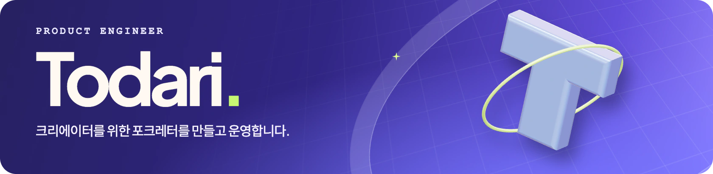

  <a href="https://todari.dev">
    <picture>
      <source media="(max-width: 600px)" srcset="https://raw.githubusercontent.com/Todari/Todari/main/.github/profile/hero-360.webp">
      
    </picture>
  </a>

  <a href="https://todari.dev"><strong>포트폴리오 ↗</strong></a> &nbsp;·&nbsp;
  <a href="https://todari.dev/writing">기술 글</a> &nbsp;·&nbsp;
  <a href="https://youtu.be/k1yPXmv8H6o">우수타 EP9</a> &nbsp;·&nbsp;
  <a href="mailto:hello@todari.dev">이메일</a>

## 대표 프로젝트

  
  
  
  

전체 프로젝트 12개

- [Forcletter](https://forcreator.co.kr) · 인스타그램·유튜브 크리에이터 운영 도구
- [이정표](https://jeongpyo.com) · KBO 티켓 팬투팬 정가 양도
- [AiBright](https://aibright.ai) · AI 검색 관측과 GEO·SEO 개선 자동화
- [닭발 헌터](https://dakbal.pro) · 엽떡 닭발 판매 지점 지도
- [행동대장](https://haengdong.todari.dev) · 가입 없는 모임 정산
- [메트로놈들](https://metronome.todari.dev) · 실시간 협업 메트로놈
- [핀투게더](https://pintogather.todari.dev) · 친구들과 함께 만드는 여행 계획 지도
- [React Pixel UI](https://react-pixel-ui.vercel.app) · CSS를 픽셀 아트로 바꾸는 UI 라이브러리
- [Trade Tower](https://trade-tower.vercel.app) · 틱 기반 자동매매 운영 시스템
- [HGT](https://hgt.todari.dev) · 홍익대 구성원 주간 1대1 매칭
- [톡사이](https://toksai.todari.dev) · 카카오톡 관계 신호 분석
- [LVTI](https://lvti.my) · 16가지 연애 성격 유형 테스트

기술 글과 공개 코드

- 포크레터 · [수집 워커 교체](https://todari.dev/writing/bluegreen-on-one-ec2#collector-cutover) · [광고 단가 모델](https://todari.dev/writing/creator-price-estimates) · [릴스 제작 파이프라인](https://todari.dev/writing/marketing-reels-pipeline) · [iOS와 웹 호환성](https://todari.dev/writing/native-web-layout-compatibility)
- AiBright · [GEO 관측에서 CMS 편집까지](https://todari.dev/work/geo-seo-automation)
- 구현 PR · [메트로놈 동기화](https://github.com/Todari/metro-nomedeul/pull/12) · [행동대장 차등 정산](https://github.com/woowacourse-teams/2024-haeng-dong/pull/594)
- 개발 도구 · [Workspace AI Harness](https://github.com/Todari/workspace-ai-harness) · [Todari Ops](https://github.com/Todari/todari-ops)

기술 스택과 GitHub 활동

  

<picture>
  <source media="(prefers-color-scheme: dark)" srcset="https://raw.githubusercontent.com/Todari/Todari/output/github-snake-dark.svg" />
  <source media="(prefers-color-scheme: light)" srcset="https://raw.githubusercontent.com/Todari/Todari/output/github-snake.svg" />
  
</picture>

