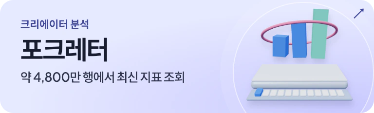

  <a href="https://todari.dev">
    <picture>
      <source media="(max-width: 600px)" srcset="https://raw.githubusercontent.com/Todari/Todari/main/.github/profile/hero-360.webp">
      
    </picture>
  </a>

  
  
  
  

  
  
  
  

  <a href="https://todari.dev/works#works">전체 프로젝트 12개 ↗</a> &nbsp;·&nbsp;
  <a href="https://github.com/Todari/Todari/blob/main/.github/profile/code.md">공개 코드 ↗</a>

---

  

<picture>
  <source media="(prefers-color-scheme: dark)" srcset="https://raw.githubusercontent.com/Todari/Todari/output/github-snake-dark.svg" />
  <source media="(prefers-color-scheme: light)" srcset="https://raw.githubusercontent.com/Todari/Todari/output/github-snake.svg" />
  
</picture>

